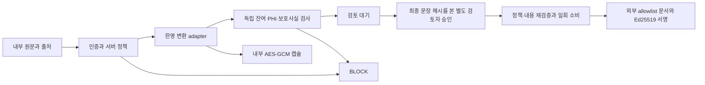

# Clinical CDS Gateway

작성·검증: 2026-10-08. **한영 임상 텍스트 후보가 정책·독립 검사·검토 승인을 통과했을 때만 로컬 외부 저장소에 생성되는 실행 가능한 시제품**이다. `ClinicalTextDeid`의 실제 공개 한국어/영어 탐지기 연결도 실행했다. 실제 환자정보, 병원망, 외부 AI API는 사용하지 않았다.

현재 반출 허용 범위는 서버에 등록된 합성 입력과 정답 출력이다. 다른 자유서술은 REVIEW 또는 BLOCK이며, 사람이 승인 API를 호출해도 실제 반출은 활성화되지 않는다. 이 범위는 임상 검증 제품이나 법적 익명정보 판정과 구별한다. 내부 S→외부 O는 기관별 등급 결정이 필요한 모의 N2SF 시나리오다.

## 실행

이 폴더에서 Windows Python 3.11 기준으로 실행한다. 각 데모의 root는 새 빈 폴더여야 한다.

```powershell
python -m venv .venv
.\.venv\Scripts\python.exe -m pip install --require-hashes --only-binary=:all: -r requirements-win-py311.lock
.\.venv\Scripts\python.exe -m unittest discover -s tests -v
.\.venv\Scripts\python.exe demo.py --root runtime\synthetic-demo
.\.venv\Scripts\python.exe demo.py --root runtime\bilingual-demo --adapter deid-hybrid
```

첫 데모는 정해진 합성 4문서를 실제 외부 파일로 반출한다. 둘째는 `ClinicalTextDeid.api.transform`의 **hybrid** 경로(ko-pii + Presidio/spaCy)를 실제 호출한 한영 문서 1개를 승인 후 반출한다. 둘째의 입력은 `성명: 김민준. Patient name: John Smith. No evidence of MI. BP 120/80 mmHg.`이고, 두 이름을 서로 다른 토큰으로 치환하며 MI 부정과 혈압·단위를 유지한다. 힌트는 사용하지 않는다. 이 한 사례를 범용 탐지 성능으로 계산하지 않는다.

hybrid 연결은 이미 설치된 형제 프로젝트 `ClinicalTextDeid/.venv/Scripts/python.exe`를 읽기 실행하며 모델을 내려받지 않는다. 다른 컴퓨터에서는 형제 프로젝트 README에 따른 환경을 먼저 구성한다. 설치된 환경이 없거나 모델을 사용할 수 없으면 BLOCK이다. 공개 정규식만 연결하는 `--adapter deid`도 제공한다. 실제 자유서술의 위험·임상 검증은 이 연결로 해결되지 않는다.

검증 완료된 현 로컬 결과: `demo-runtime-final/demo-summary.json`(합성 4개), `demo-runtime-hybrid-final/demo-summary.json`(실제 hybrid 1개). 외부 파일은 각 root의 `external/*.json`, 키·토큰·암호화 원문·감사는 `internal/`에 있다. 데모가 사용하는 역할 토큰은 모두 같은 로컬 계정으로 생성되는 모의 인증이다. 이 계정 분리를 운영환경 보안으로 해석하지 않는다.

## 수동 검토와 반출

서버 상태가 승인 근거다. 요청 JSON에 `approved`, `is_safe`, 사용자 역할, 법적 승인 주장 등을 추가하면 스키마가 거부한다. 목적은 `scientific-research`, 프로젝트는 `demo-research`, 수신처는 `local-research`만 등록되어 있다. 해당 등록은 합성 시나리오이고 실제 기관 연구 승인서가 아니다.

```powershell
.\.venv\Scripts\python.exe -m gateway.cli --root runtime\manual init
# 합성 입력 JSON을 내부에 만든다. 원문을 stdout에 출력하지 않는다.
.\.venv\Scripts\python.exe -c "from pathlib import Path; from gateway.common import canonical; from gateway.fixtures import request; Path('runtime/manual/internal/request.json').write_bytes(canonical(request('connected-hybrid')))"
$submitted = .\.venv\Scripts\python.exe -m gateway.cli --root runtime\manual submit --request runtime\manual\internal\request.json --token-file runtime\manual\internal\submitter.token --adapter deid-hybrid | ConvertFrom-Json
.\.venv\Scripts\python.exe -m gateway.cli --root runtime\manual inspect --release $submitted.release --token-file runtime\manual\internal\reviewer.token --output runtime\manual\internal\review.json
# 검토자는 이 파일에서 최종 후보문장과 검사 사유를 실제로 읽는다.
$review = Get-Content -Raw runtime\manual\internal\review.json | ConvertFrom-Json
.\.venv\Scripts\python.exe -m gateway.cli --root runtime\manual approve --release $submitted.release --token-file runtime\manual\internal\reviewer.token --expected-text-sha256 $review.text_sha256
$exported = .\.venv\Scripts\python.exe -m gateway.cli --root runtime\manual export --release $submitted.release --token-file runtime\manual\internal\exporter.token | ConvertFrom-Json
.\.venv\Scripts\python.exe -m gateway.cli --root runtime\manual verify --file $exported.file
```

CLI `inspect`/`restore`는 내부 하위 경로의 새 파일로만 저장한다. 후보·원문은 stdout이나 감사 export에 출력하지 않는다. `revoke`로 REVIEW/APPROVED 승인을 취소할 수 있고, `audit`는 값 없는 사유코드·불투명 공개ID만 출력한다. 프로그래밍용 `inspect`와 `restore_internal`은 내부 검토자 API이며 외부 전송에 쓰지 않는다.

## 흐름과 결과



반출 직전에 같은 정책·원문·후보·문서·회차·목적·수신처인지 다시 확인한다. 최종 공개문서와 정책 해시를 서명하며, SQLite 트랜잭션에서 승인을 먼저 소비한다. 동일 문서의 새 제출은 과거 승인을 무효화한다. 소비 이후 파일 쓰기 실패나 프로세스 장애는 반출을 잃을 수 있으나 그 승인으로 재전송하지 않는다. 전달 보장은 제공하지 않는다.

기본 임상 계약은 환자 숫자 나이, 운동 시점, 가족 주체, MI와 사망, 가족 사건 나이, 질환 부정·확실성, 위치, 약물 용량·경로·횟수·상태를 보존하고 성별 추론을 금한다. 이름·기관·특정 행사명 등은 정해진 합성 범위에서 제거/축소한다. 47→중년, last Sunday→최근, 부친 MI 사망52→조기MI 가족력만 남기는 변환은 이 기본 정책에서 차단된다. 별도 일반화 정책의 임상 손실 승인 기능은 구현하지 않았다.

## 연구 결론과 한계

[N2SF 원문 조사](docs/N2SF_RESEARCH.md), [법령·최신 지침 조사](docs/LEGAL_RESEARCH.md), [직접 선행·공개 구현](docs/PRIOR_AND_SUPPLY_CHAIN.md)을 확인했다. 2025 N2SF 1.0 모델11 p40에는 이미 CDS 외부 전송의 비식별화·마스킹이 있다. 2026.5.1 국가 사이버보안 기본지침 제39조의2~5도 구분해 확인했다. 2025.12. 보건의료 가이드 p20에는 문자열과 문장 의미·전후 사정·별칭 위험 검토가 있으며, 최신 가명정보 가이드는 2026.3.이다. 따라서 CDS 배치 위치나 의료 문자열 처리 자체만으로 발명 신규성을 주장하지 않는다.

현재 테스트 **47개 통과**. [검증 결과](docs/VALIDATION.md), [기준→통제→실행 시험 대응표](docs/CONTROL_MATRIX.md), [위협모델과 우회 범위](docs/THREAT_MODEL.md), [입출력 계약](INTERFACE.md)을 제공한다. 테스트는 알려진 합성 범위와 애플리케이션 경로의 기능 증거다. 외부 저장소에 직접 쓰기 가능한 같은 OS 사용자, 서버 코드·키 접근자, DB 전체 rollback, 감사 suffix 삭제는 이 데모가 통제하지 못한다. 실제 인증 CDS, 전면 CDR, 전수 자유서술 의미 검사, 법정 로그보존·수신자 회수/파기·국외이전 허용은 구현/인증하지 않았다.

